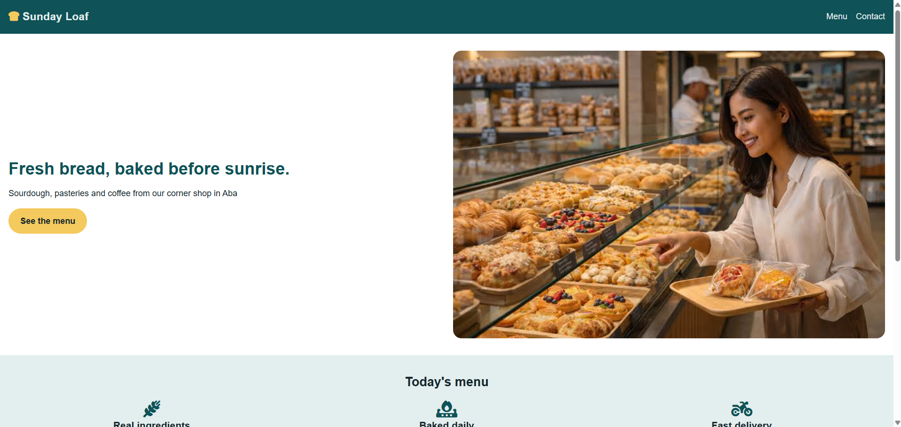
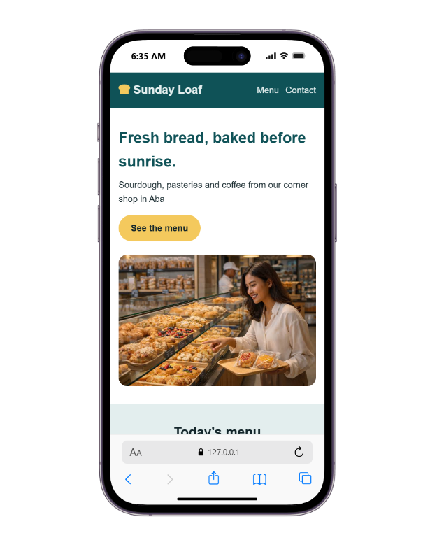
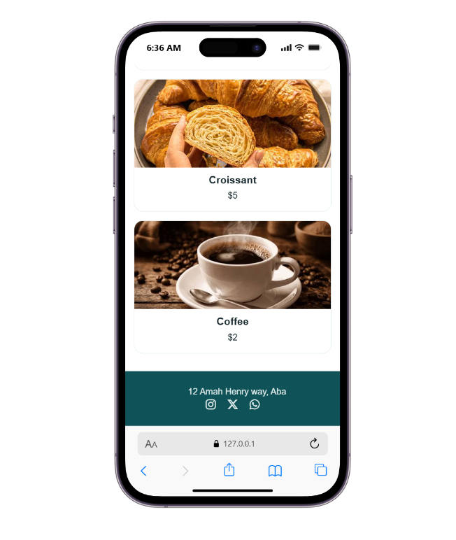

# Sunday Loaf Bakery

A simple, responsive landing page for Sunday Loaf, a neighborhood bakery in Aba. The page introduces the bakery, highlights its daily offerings, displays a small menu, and provides contact and social links.

## Preview

### Desktop

<p align="center">
  
</p>

### Mobile

<table>
  <tr>
    <td align="center"></td>
    <td align="center"></td>
  </tr>
</table>

## Features

- Bakery branding and navigation links
- Hero section with a featured image and menu call to action
- Highlights for ingredients, daily baking, and delivery
- Menu cards for sourdough, croissants, and coffee
- Responsive layouts built with CSS Flexbox
- Font Awesome icons via CDN

## Getting started

This is a static HTML and CSS project. No build tools or package installation are required.

1. Clone the repository:

   ```bash
   git clone https://github.com/your-username/sunday-loaf-bakery.git
   ```

2. Move into the project directory:

   ```bash
   cd sunday-loaf-bakery
   ```

3. Open `index.html` in your browser. You can also use a local development server, such as the VS Code Live Server extension.

## Project structure

```text
sunday-loaf-bakery/
├── assets/
│   └── images/
│       ├── sunday-loaf.png              # Desktop preview
│       ├── sunday-loaf-mobile1.png      # Mobile homepage preview
│       └── sunday-loaf-mobile2.png      # Mobile menu and footer preview
├── index.html                           # Bakery landing page markup
├── style.css                            # Colors, typography, and responsive Flexbox layouts
└── README.md                            # Project overview and setup instructions
```

## Customization

- Update the bakery name, address, menu items, and prices in `index.html`.
- Edit the CSS custom properties near the top of `style.css` to change the color palette.
- Replace the sample image URLs with images you own or are licensed to use.
- Replace `your-username` in the clone URL with your GitHub username.

## Built with

- HTML
- CSS (Flexbox)
- [Font Awesome 6.5.2](https://fontawesome.com/)
# Simple-responsive-website
